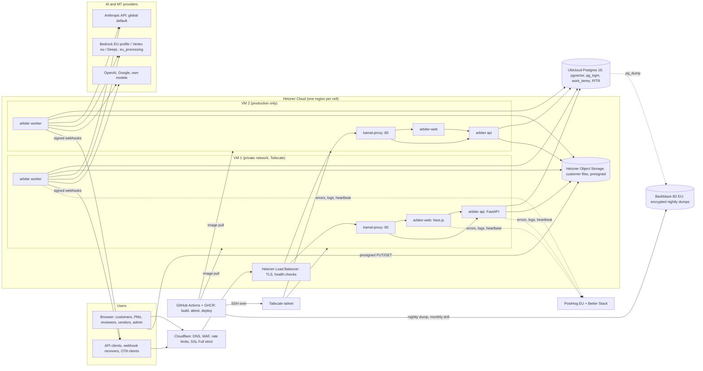

# Infrastructure

How Arbiter runs outside a laptop: requirements, the options compared, the chosen architecture, environments, network and secrets, deploy flow, backup and restore, scaling path, cost ranges, and what is built versus what still needs accounts. Decisions: D-079 to D-083 (hosting, database, storage, observability), D-084 and D-085 (money), D-086 (compliance). Status 2026-10-13: nothing is deployed; staging is P02, production P04.

Facts marked "research" come from the infrastructure research report of October 2026 (kept outside the repo); the original source is linked so it can be re-checked. Every price is either such a dated fact or labelled **estimate**; estimates are confirmed through the provider's API or console in the phase that creates the resource, and the confirmed price goes into `hyperpower.json` `spend` before creation.

## 1. Requirements

| Requirement | Why | Where it is met |
| --- | --- | --- |
| Postgres 16 with `vector` and `pg_trgm` | TM vectors (D-003), fuzzy TM, the `work_items` queue, append-only provenance trigger | Ubicloud managed Postgres (D-081), pgvector verified first (INT-04) |
| Point-in-time recovery plus an off-provider copy | questionnaires ask for PITR; provider loss and operator error need a second copy | Ubicloud PITR + nightly encrypted dump to Backblaze B2 EU + monthly restore drill (D-082) |
| Long-running workers | the pipeline, email, payouts and training polls run as `work_items` consumers | `worker` role on every VM (Kamal), safe in parallel because the queue claims rows |
| Uploads up to 1 GB without passing through the app or the CDN | Cloudflare caps proxied request bodies by plan; memory on the API | presigned PUT straight to Hetzner Object Storage (D-051) |
| No single VM failure takes the product down | paying customers from P04 | two or more production VMs behind a Hetzner Load Balancer (D-080) |
| Deploys that prove what runs | evidence-first operating model | CI builds and attests images, Kamal deploys by commit SHA, `npm run verify:deployed` compares `/healthz` commit with HEAD |
| No public SSH | smaller attack surface, one access path to audit | Tailscale for operators and CI (D-080) |
| EU processing on request, never silently global | sold as the `eu_processing` add-on (D-079) | engines declare a region; EU orgs only reach EU engines; region in provenance |
| Errors, logs, uptime, heartbeat, status page, phone alert | one operator | PostHog EU + Better Stack, OpenTelemetry in code (D-083) |
| Segment text never in observability tools | confidential customer documents | PostHog privacy mode, no text in logs or events (built) |
| A US cell later without a rewrite | US buyers, US-region contracts | region chosen at signup, one deployment per region (section 9) |

## 2. Options compared

| Option | Monthly cost now | Managed Postgres with pgvector and PITR | Redundancy | Ops load for one person | Compliance story | Verdict |
| --- | --- | --- | --- | --- | --- | --- |
| **Hetzner Cloud VMs + Hetzner LB + Ubicloud Postgres + Kamal 2** (chosen) | lowest of the redundant options (**estimate**, section 10) | Ubicloud: from 19.54 USD per month, 7-day per-minute restore (research, [Ubicloud](https://www.ubicloud.com/docs/about/pricing)); pgvector to verify | 2+ VMs behind LB; DB HA per Ubicloud plan (to confirm) | medium: VMs patched by us, DB managed | Hetzner ISO 27001:2022 for German parks (research, [Hetzner](https://www.hetzner.com/de/unternehmen/rechenzentrum?country=us)); Ubicloud SOC 2 per owner, to confirm | chosen (D-080, D-081) |
| Single Hetzner box, Compose + Caddy, Postgres on a volume (D-013) | lowest | none: we run Postgres | none | high: we own DB ops, backups, failover | weakest | rejected for staging and production; kept for local dev and emergency fallback |
| Coolify on Hetzner | low | no | depends | operational trouble on another of the owner's projects | weak | rejected |
| Kubernetes (managed or self-run) | medium to high | via add-ons | yes | high: too many moving parts pre-scale (research agrees) | neutral | rejected |
| AWS full stack in eu-central-1 (research recommendation) | about 3 to 5 times the chosen stack (owner's **estimate**, not measured) | RDS (pgvector and small Multi-AZ price not verified, research) | yes | low to medium | strongest: inherited AWS reports; category norm (Lokalise, Crowdin, Smartling, Phrase on AWS, research) | kept as the enterprise-region profile, triggered by a contract (P09) |
| Scaleway managed | low to medium | pgvector and PITR not confirmed | yes | low | EU provider | rejected now; fallback for the DB if Ubicloud fails the check and Scaleway passes it |
| Vercel + Neon or Supabase + Render | low at first, grows with usage | Supabase PITR add-on 100 USD per month (research, [Neon comparison](https://neon.com/guides/neon-launch-plan-vs-supabase-pro-plan)) | yes | low | many US subprocessors | rejected: long-running workers awkward, subprocessor sprawl |

## 3. Chosen architecture

- Two Kamal services share each VM and its kamal-proxy: `arbiter` (image `ghcr.io/spawnjfk/arbiter-api`, roles `api` with proxy and `/healthz`, `worker` without proxy) and `arbiter-web` (image `ghcr.io/spawnjfk/arbiter-web`, role `web`, `/api/health`). The web container reaches the API on the same host through the network alias `arbiter-api`, never out through Cloudflare (`deploy/kamal/config/deploy.web.yml`).
- Migrations run once per deploy in the Kamal `pre-deploy` hook on the primary api host, in a container of the new image, before traffic moves; the API's own migrate-on-start is off (`ARBITER_MIGRATE_ON_START=0`). Migrations stay additive and backward compatible (expand, deploy, contract).
- TLS: Cloudflare to the load balancer in Full (strict); the load balancer forwards plain HTTP to port 80 on the private network. Hetzner managed certificates need the zone in Hetzner DNS (to verify in P02); with Cloudflare DNS the expected path is a Cloudflare Origin CA certificate uploaded to the load balancer. `deploy/kamal/README.md` still says "Hetzner managed certificate"; P02 corrects it after the check.
- Uploads and downloads go browser to bucket through presigned URLs, never through Cloudflare or the app.

## 4. Environments

| | Local | Staging | Production |
| --- | --- | --- | --- |
| Where | the owner's Windows machine (`E:\arbiter`), Docker Desktop | Hetzner, 1 VM, region chosen in P02 | Hetzner, 2+ VMs behind a load balancer, same region as staging |
| Hostnames | `localhost:3000` web, `:8000` api | `app.staging.<domain>`, `api.staging.<domain>` | `app.<domain>`, `api.<domain>` |
| Database | `deploy/docker-compose.dev.yml` (pgvector/pgvector:pg16), dbs `arbiter`, `arbiter_test` | Ubicloud, smallest plan that passes INT-04 | Ubicloud, HA plan if offered (to confirm) |
| Files | local backend, HMAC-signed blob endpoint | Hetzner Object Storage bucket `arbiter-stg-*` | bucket `arbiter-prd-*` |
| Providers | mock providers; real keys only in P01 | real keys with spend caps; Paddle and payout sandboxes | live keys (P03 and P04) |
| Deploy | `make api`, `make worker`, `make web` | CI on every green `main` (`release.yml`, `deploy-staging`) | CI on a `v*` tag after manual approval (`deploy-production`) |
| Data | fictional seed (`seed-demo`) | fictional seed plus test orgs; never customer data | customer data |
| Fallback | | | `deploy/docker-compose.yml` + Caddy on one VM if the Kamal path is broken (emergency only, D-080) |

The Compose stack (`deploy/docker-compose.yml`, `deploy/Caddyfile`, `deploy/backup.sh`) stays valid in CI (`compose config`) so the fallback works when needed.

## 5. Network and secrets

Network:
- Inbound from the internet reaches only Cloudflare. The Hetzner Cloud Firewall allows 80 and 443 from the load balancer and the private network only; port 22 is closed once Tailscale works.
- SSH: Tailscale only. VMs join with `--advertise-tags=tag:arbiter`; CI joins with an OAuth client tagged `tag:ci`; the ACL lets `tag:ci` reach `tag:arbiter` on 22. Operators reach the VMs over the tailnet.
- Postgres: Ubicloud allows only the VMs' egress addresses (and the backup runner path, see section 7), TLS required (`sslmode=require`).
- Object storage: private buckets, CORS limited to the app origin with `PUT, GET, HEAD`, presigned URLs with short TTLs (`ARBITER_UPLOAD_URL_TTL_SECONDS`, `ARBITER_DOWNLOAD_URL_TTL_SECONDS`).
- Cloudflare: WAF managed rules and rate limits on `/v1/auth/*` and public form endpoints (in addition to `ARBITER_RATE_LIMIT_PER_MINUTE` in the API).

Secrets:
- Source of truth: GitHub environment secrets (`staging`, `production`, `backup`). `.kamal/secrets-common` only reads environment variables of the same name; no value is ever committed.
- Names: every `ARBITER_*` field in `services/api/arbiter/config.py`; the deploy needs at least `ARBITER_DATABASE_URL`, `ARBITER_JWT_SECRET`, `ARBITER_SECRETS_KEY`, the `ARBITER_S3_*` set, SMTP settings, and the provider keys in use. CI needs `TS_OAUTH_CLIENT_ID`, `TS_OAUTH_SECRET`; backups need `ARBITER_BACKUP_DATABASE_URL`, `B2_KEY_ID`, `B2_APP_KEY`, `B2_BUCKET`, `B2_ENDPOINT`, `BACKUP_PASSPHRASE`.
- Gap to close in P02: `deploy/kamal/config/deploy.yml` does not yet list `ARBITER_SECRETS_KEY`, the Bedrock and Vertex settings, or the billing and payout keys among its `env.secret` names, and `release.yml` passes only the names it lists. P02 adds them (P02 for the deploy basics, P03 for billing and payouts).
- Engine keys entered in the UI (platform keys, customer BYOK) and SSO client secrets are Fernet-encrypted in the database under `ARBITER_SECRETS_KEY` (D-056, D-078). Rotation is in `SECURITY.md`.
- GitHub plan check (P02): per GitHub's documentation as understood at writing, environment secrets on a private repository need GitHub Pro, Team or Enterprise, required reviewers on a private repository need Enterprise, and artifact attestations on a private repository need Enterprise Cloud. P02 confirms the current rules and the account's plan before relying on them and records the outcome as a decision (options: upgrade the plan as declared spend, or repository-level secrets with destination prefixes, a tag-push restricted to the owner instead of required reviewers, and image digests recorded in the evidence ledger instead of attestations).

## 6. Deploy flow

1. Push to `main`. `ci.yml` runs ruff, pytest, web lint with i18n, typecheck, build, both Docker builds and the compose check.
2. `release.yml` starts after a green `ci` on `main` (or on a `v*` tag): builds `arbiter-api` and `arbiter-web` for `linux/amd64` with `ARBITER_GIT_SHA` and `ARBITER_VERSION` baked in, pushes them to GHCR tagged with the commit SHA, and attests build provenance (`actions/attest-build-provenance`).
3. `deploy-staging` (main) or `deploy-production` (tag, GitHub environment approval): preflight lists missing secrets and skips cleanly; then Ruby + Kamal 2.7, Tailscale with `tag:ci`, `kamal deploy -d <dest> --version <sha> --skip-push` for the API service (pre-deploy hook migrates), then the same for `config/deploy.web.yml`.
4. Verify: `scripts/verify-deployed-version.mjs` polls `<API_URL>/healthz` until its `commit` equals the SHA (10 tries, 15 s apart). Locally the same check is `npm run verify:deployed`, which reads `hyperpower.json` `shipped.<env>.apiUrl`.
5. Evidence: a replayable `cli` record per deploy check (INT-05), and the attestation checked with `gh attestation verify` (INT-08) once the plan allows it.
6. Rollback: `kamal rollback -d <dest> <previous sha>`; the last five images stay on each host. Only safe because migrations are backward compatible.

## 7. Backup and restore

| Layer | What | Where | Proof |
| --- | --- | --- | --- |
| PITR | continuous WAL, per-minute restore (research: 7 days on Ubicloud) | Ubicloud | a PITR restore into a new instance, once in P02, duration recorded |
| Nightly dump | `pg_dump -Fc`, row-count manifest, GPG AES256 with `BACKUP_PASSPHRASE`, 02:17 UTC | Backblaze B2 EU, 35 daily copies by lifecycle rule | `backup.yml` job log and the manifest |
| Restore drill | newest dump restored into a scratch pgvector Postgres in CI, checksum, alembic version, no populated table emptied; 04:41 UTC on the 3rd of each month | GitHub Actions artifact `restore-drill.json`, kept 400 days | INT-07, replayable record over the stored JSON |
| Customer files | object storage bucket | Hetzner Object Storage | copy policy (versioning or nightly sync to B2) decided in P02 |

If the database only accepts the VMs, the dump runs through a tailnet host (`BACKUP_SSH_HOST`); the URL travels on stdin, never on a command line. The full manual restore procedure for production lives in `deploy/README.md`.

Data path to note: in both modes the plaintext dump passes through a GitHub-hosted runner before `gpg` encrypts it, and the drill decrypts a dump on a runner. That makes GitHub a processor of the full database (listed in `docs/subprocessors.md`). P02 decides, with a decision entry, whether to accept that or to move dump and drill onto a self-hosted runner on the tailnet.

## 8. Observability

- PostHog EU: exceptions (API, worker, web), logs over OTLP, product events, LLM generation events with privacy mode on (no prompt or completion text). Never segment text.
- Better Stack: HTTP checks on `https://api.<domain>/healthz` and `https://app.<domain>/api/health`, a heartbeat the worker pings every `ARBITER_HEARTBEAT_INTERVAL_SECONDS` (`ARBITER_HEARTBEAT_URL`), a public status page, phone alerts from P04.
- Queue depth and oldest `ready` age from `work_items` (runbook queries); database metrics from Ubicloud.
- Research facts behind the split are in D-083.

## 9. Scaling path

1. **API and web**: horizontal. Add a VM to the destination file, `kamal deploy`; the load balancer health check adds it.
2. **Workers**: horizontal. Workers on every VM; a dedicated worker VM (role `worker` only) when LLM calls and file conversion compete with requests. The Postgres queue makes parallel workers safe.
3. **Database**: vertical first (larger Ubicloud plan), then a read replica for dashboards and exports, then splitting heavy tables only if measurement shows a need.
4. **Files**: object storage scales by itself; large conversions move to a dedicated worker VM.
5. **Regions (cells)**: a US cell is a second, independent deployment, not a stretched one. Research: every comparable product that offers both regions runs fully separate deployments, the region is picked once at signup, hostnames differ, and accounts are not migrated. Phrase customers choose EU or US at signup and accounts "cannot be moved" ([Phrase support](https://support.phrase.com/hc/en-us/articles/5748008399388)); Linear's storage location "cannot be changed for existing workspaces" ([Linear](https://linear.app/changelog/2024-05-23-european-union-data-hosting)); PostHog EU is "an entirely independent instance" ([PostHog](https://posthog.com/blog/posthog-cloud-eu)). Arbiter follows the same pattern: region chosen at signup and stored immutably on the org, region-specific hostnames, one Kamal destination set per cell, billing (Paddle) global because it holds no customer content. The open design question is the reviewer marketplace: one global reviewer service or a pool per cell; per-cell pools are simpler for residency (research). Decided in P09.
6. **Enterprise region**: the AWS profile (P09) when a contract requires a hyperscaler or a specific region; same images, a different destination and managed services.

## 10. Cost ranges

Nothing is paid today. All figures below are ranges for planning, not quotes.

| Item | Staging | Production at launch | Basis |
| --- | --- | --- | --- |
| Hetzner VMs | 1 small shared-vCPU VM | 2 VMs, dedicated vCPU once LLM traffic and conversion overlap | **estimate**, read from `hcloud server-type list` in P02 and P04 |
| Hetzner Load Balancer | optional (one VM) | 1 small LB | **estimate**, `hcloud load-balancer-type list` |
| Hetzner Object Storage | base price plus usage | same | **estimate**, Hetzner console price page in P02 |
| Ubicloud Postgres | smallest plan, from 19.54 USD per month | HA plan, price to confirm | research ([Ubicloud](https://www.ubicloud.com/docs/about/pricing)); HA price **estimate** |
| Backblaze B2 | a few GB | grows with dumps | **estimate**, B2 pricing page in P02 |
| Cloudflare | free plan expected to suffice | free or Pro if WAF rules need it | **estimate**, confirm WAF and rate-limit features per plan in P02 |
| Tailscale | free tier expected for a few devices | same | **estimate**, confirm plan terms for business use in P02 |
| GHCR | private package storage and transfer within the account's allowance | same | **estimate**, check the account plan in P02 |
| PostHog EU | free tiers (100K exceptions, 10 GB logs per month) | then 0.25 USD per GB logs | research ([PostHog](https://posthog.com/docs/logs/pricing)) |
| Better Stack | free tier: 10 monitors and heartbeats, 1 status page | plus one responder seat, 34 USD per month (29 yearly) | research ([Better Stack](https://betterstack.com/pricing.md)) |
| Paddle | none until a sale | 5 % + 50 cents per transaction | research ([Paddle](https://www.paddle.com/pricing)) |
| AI and MT providers | P01 budget named with "apply" (suggested 50 EUR) | usage, capped by `engine_budgets` | provider consoles |
| EU processing route | P01 or P02 test calls | about 10 % more on residency-pinned Vertex spend | research ([Claude on Vertex](https://platform.claude.com/docs/en/api/claude-on-vertex-ai)) |

Ceilings that "apply" authorises are in each phase file and in `hyperpower.json` `spend.planned`.

## 11. Built versus needs accounts

| Piece | Built in the repo | Needs the owner (accounts, keys, clicks) |
| --- | --- | --- |
| Images, CI, release with attestation | `ci.yml`, `release.yml`, both Dockerfiles | GitHub plan check; GHCR works with the repo's `GITHUB_TOKEN` |
| Kamal configs and hooks | `deploy/kamal/` (two services, staging and production destinations, pre-deploy migration hook, secrets reader) | VMs, domain, GitHub environment secrets and variables |
| Load balancer, firewall, VMs | created by the agent through `hcloud` | Hetzner account, project and API token |
| Database | migrations 0001 to 0011, `alembic upgrade head == create_all` test | Ubicloud account and API token or console access |
| Object storage and presigned uploads | `storage.py`, `/v1/uploads`, `lib/upload.ts`, S3 tests with moto | Hetzner Object Storage bucket and S3 credentials |
| Backups and drill | `backup.yml` | Backblaze B2 account in the EU region, bucket, application key, a passphrase |
| Edge | | Cloudflare account, the domain's nameservers, an API token |
| SSH path | Tailscale steps in `release.yml` and `backup.yml` | Tailscale account, tags, ACL, OAuth client |
| Observability | `observability.py` (PostHog, OpenTelemetry, heartbeat) | PostHog EU project key, Better Stack monitors, heartbeat URL, status page |
| Email | queued email, SMTP mailer (D-051) | a transactional SMTP provider, chosen in P02 (decision entry), plus domain DNS records |
| Payments and payouts | Paddle, Stripe (off), manual; Payoneer, PayPal, bank files (D-072, D-073) | Paddle, Payoneer, PayPal accounts (P03) |
| EU processing | Bedrock and Vertex clients, region filter (D-057) | AWS account with Bedrock model access in an EU region, or a Google Cloud project with Vertex (P01 or before the first EU customer) |
